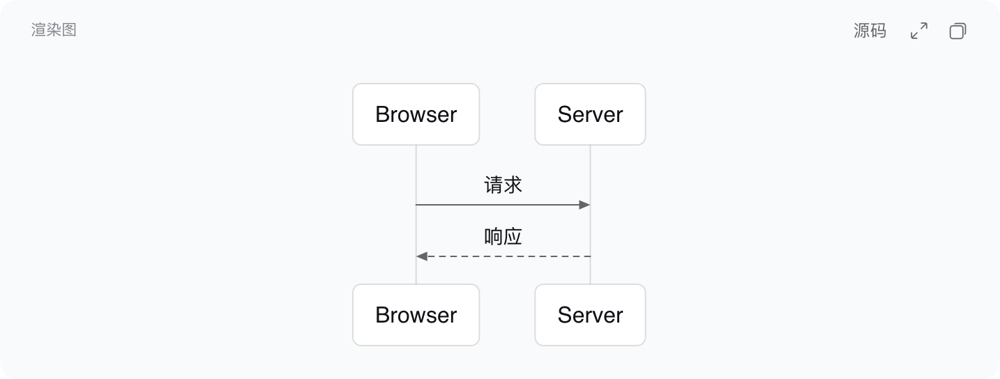
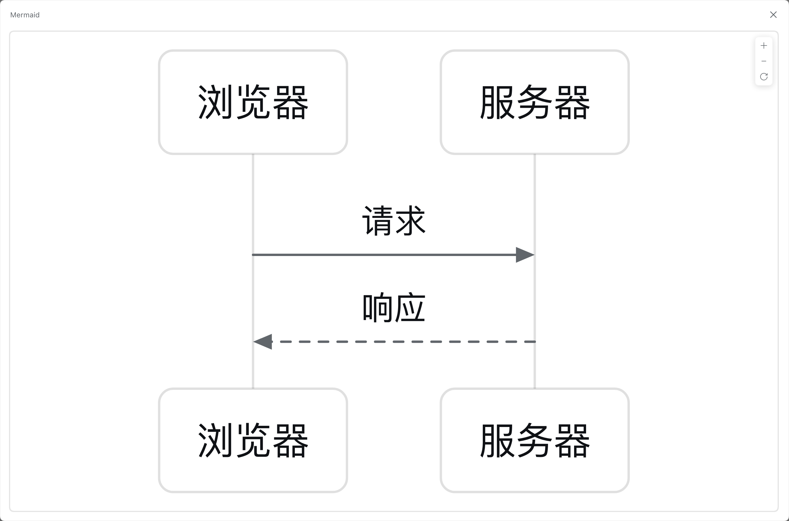
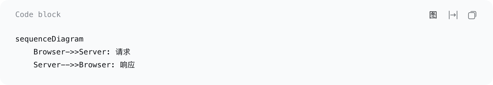
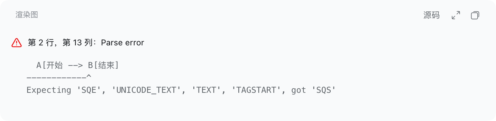

# dsh-mermaid

> Render Mermaid code blocks directly in [DeepSeek Harness](https://deepseek.com) as diagrams, with an in-place source toggle, a zoomable preview, and image copy.

DeepSeek Harness 默认把 ` ```mermaid ` 代码块当普通代码显示。这个插件把它**就地**变成图：默认看到图，需要时在块内切回源码；点开放大可任意缩放/平移，也可以把图复制成 PNG。



## 特性

- **就地渲染**：` ```mermaid ` 代码块默认显示渲染图，不改变消息结构、不新增卡片或图册。
- **图 / 源码切换**：图态按钮「源码」、源码态按钮「图」；两态外观一致、右边缘固定、图标不位移。
- **标题跟随视图**：图态显示「渲染图」/ `Diagram`，源码态恢复 DSH 原本的标题（`Code block` / `代码块`）。
- **中英文**：跟随 DSH 界面语言自动切换（`<html lang>`）：标题、切换按钮、提示与预览的无障碍文案、错误提示都会实时换词。
- **保留原生能力**：源码态下官方复制、官方「自动换行」照常可用；图态复制按钮改为复制图片。
- **复制图片**：PNG 写入剪贴板（2× 输出、主题色正确、SVG 内联变量后光栅化）；成功反馈只把图标换成 ✓，失败静默。
- **放大预览**：固定画布、整图居中、`0.35×` ~ `8×` 任意缩放、任何级别可拖拽、双击/按钮复位、`Esc` 关闭。
- **错误降级**：语法错误时**只把图表内容换成错误提示**（同样的卡片、banner、按钮与「源码」切换，交互不变），提示与 pele playground 同构：头部 `⚠ 第 N 行，第 M 列：首行原因`，下面是等宽明细（出错行 + `^` 指示 + `Expecting …`）；切到源码后保持源码态（不会被错误面板拽回）；流式输出中的半截源码不会误报。
- **主题联动**：跟随 DSH 亮/暗主题，切主题不重新渲染；连线标签的遮罩用卡片真实底色，不会"线穿字"。
- **长图策略**：会话内不限高度，按容器全宽等比渲染，由消息列表自身滚动承载。

## 截图

| 图态 | 放大预览 | 源码态 | 语法错误 |
|---|---|---|---|
|  |  |  |  |

## 安装

要求：DeepSeek Harness 桌面端 **0.2.2-rc.1**（插件依赖该版本 Web 界面的 DOM 契约，见「兼容性」）。

```sh
git clone https://github.com/tsx8/dsh-mermaid.git
```

然后在 DSH 中安装（把路径换成本机实际路径）：

```text
plugin_manager action=install_bundle target=/absolute/path/to/dsh-mermaid
```

也可以直接使用 Git 地址（由 pnpm 拉取）：

```text
plugin_manager action=install_bundle target=git+https://github.com/tsx8/dsh-mermaid.git
```

安装完成后**重启桌面端**（桌面窗口的 boot injections 只在 Host ready 时抓取一次）。

卸载：

```text
plugin_manager action=remove_bundle target=dsh-mermaid
```

## 使用

**块内**

| 控件 | 图态 | 源码态 |
|---|---|---|
| 切换 | `源码` | `图` |
| 放大 | `⤢`（或直接点图） | 隐藏 |
| 复制 | 复制图片（PNG） | 官方复制（源码文本） |
| 换行 | 隐藏 | 官方「自动换行」 |

**放大预览**

| 输入 | 行为 |
|---|---|
| 滚轮 / 双指捏合 | 以指针为锚点缩放 |
| 拖拽 | 平移（任何缩放级别，含初始态） |
| 双击 / `0` / 复位按钮 | 回到整图居中 |
| `+` `-` / 方向键 | 缩放 / 平移 |
| `Esc` / 点遮罩 / `✕` | 关闭并归还焦点 |

## 实现要点

- **为什么是 DOM 增强**：DSH 的 Markdown 渲染器把 fenced code 统一交给 `CodeBlock`，没有按语言注册渲染器的扩展点，因此插件在 DOM 层就地增强。
- **语言识别**：DSH 高亮器不认识 `mermaid`，该 fence 走 plain 分支。插件用「plain 分支（`<code>` 无子元素）+ pele `detectType()` 能识别」双信号判定，避免误伤普通文本块。
- **不惊动 React**：不删除也不替换 React 管的 `<pre>`，只加 `display:none`；渲染图放在它的兄弟 `<figure>` 里；所有 DOM 写入先比较再写，MutationObserver 带 hash 幂等，避免自激循环。
- **相机**：移植自 pele 的 `src/zoom.ts`，保留其 `frame()` 钳制与指针锚定推导，只改四处：固定画布、`fit` 含高度、放开缩放下限、静止态可拖。
- **复制图片**：克隆 SVG → 内联 `getComputedStyle` 解析出的 `--pele-*` 变量（离页后会丢）→ `` → canvas（DPR ≤ 2×）→ `ClipboardItem('image/png')`。

## 兼容性与限制

- 目标环境：DeepSeek Harness 桌面端 **0.2.2-rc.1**。依赖 `.md-code-block` 及若干 `data-code-block-*` 属性；DSH 升级后可能需要跟进。
- 渲染库 pele 不支持 HTML 标签 label、不支持 ZenUML 等 Mermaid 外部插件，布局与官方 Mermaid 不完全一致。
- 复制图片依赖剪贴板权限；失败时静默（与官方复制失败行为一致），可切到源码态复制文本。
- 错误态下没有可放大的图、也没有可复制的图片，点「放大」「复制图片」为静默无操作（不会复制出错误图标）。
- 极端长宽比的图在会话内会显示得较小（为完整展示），细节请用放大预览。

## 开发

```sh
npm install
npm run build   # client.src.js -> client.js（esbuild，内联 pele）
npm run check   # node --check client.js
npm test        # jsdom 冒烟测试（56 项断言，无需安装 DSH）
```

`client.js` 是提交进仓库的构建产物，CI 会校验"源码重编译后与提交的产物一致"。

目录：

```
dsh-mermaid/
├── package.json            # dsh.bundle.patch + dsh.client{platform:"web"}
├── cordis.patch.yml        # 插入一行 dsh-mermaid
├── index.js                # Host 半（空 apply；能力全在浏览器端）
├── client.src.js           # 浏览器端源码（依赖 pele）
├── client.js               # 构建产物（内联 pele，单文件）
├── locale/{en,zh}.json     # 插件展示名
├── icon.svg                # 插件图标
├── test/smoke.mjs          # jsdom 冒烟测试（56 项断言）
└── docs/                   # README 截图
```

## 许可与致谢

- 本项目：[MIT](LICENSE)。
- 渲染由 [pele](https://github.com/obsidianmd/pele) 提供（MIT，Copyright © 2026 kepano）；`client.js` 内联其代码，声明见 [THIRD_PARTY_NOTICES.md](THIRD_PARTY_NOTICES.md)。
- Mermaid 语法与行为归 [Mermaid](https://github.com/mermaid-js/mermaid) 项目（MIT）。

> 本仓库以插件 bundle 形式分发，**不发布到 npm**（`private: true` 是有意保留的）。
